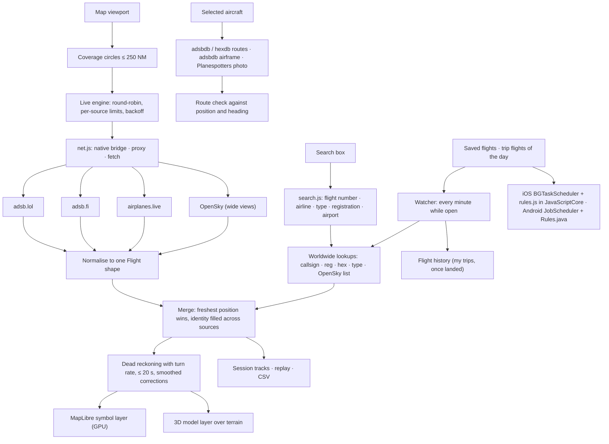

# Aeris architecture

## Data

- `src/providers.js` lists the sources, their URL builders, rate limits and terms. All readsb-style sources share one parser.
- `src/live.js` turns the viewport into coverage circles (`coverageCircles` in `core.ts`, hexagonal packing with overlap), refreshes the nearest circles every 1–2 s and outer ones less often, and alternates sources so none exceeds its limit. The selected aircraft is fetched by hex when it is outside the refreshed area. OpenSky is used only for wide views or when the readsb sources fail, within a daily credit budget kept in local storage. Errors back off per source (429 → exponential, 403 → 10 minutes).
- `src/core.ts` normalises readsb and OpenSky responses (feet, knots, ft/min; null when not reported), merges reports, predicts motion (`predicted`: constant-rate turn for up to 8 s, then straight, bounded to 20 s), checks routes (`routeFit`: cross-track distance, progress, heading) and builds great-circle lines that stay continuous across the antimeridian.
- `src/net.js` chooses the path per host: the iOS `WKScriptMessageHandlerWithReply` bridge, the Android `@JavascriptInterface` bridge, a configured proxy, or direct fetch for hosts that send CORS headers (adsbdb, hexdb, Planespotters).
- `src/enrich.js` caches lookups (routes 20 min, airframes 7 days, photos 3 days) in memory and local storage.
- `src/search.js` turns a query into lookups: IATA or ICAO flight numbers (via `data/airlines.json`, built from OpenFlights by `scripts/build-airlines.mjs` with corrections), airline names and radio callsigns, registrations, hex addresses and aircraft families. `LiveFeed.query` runs a callsign/registration/hex/type lookup against the readsb sources; `LiveFeed.snapshot` fetches OpenSky's worldwide list (cached 90 s, 4 credits) for airline lists. A moved viewport is fetched immediately.
- `src/collection.js` stores saved flights (by ICAO callsign, with alerts off / next flight / every flight), aircraft (by hex), airports, trips (named lists of dated flights with their airports) and the flight history in local storage. `evaluate` is the pure alert rule. A flight is followed one leg at a time and each kind of alert is sent at most once per leg: take-off (seen on the ground, then in the air; the airport is the one it was seen at), in the air (first seen already flying), descending into the destination (under 10,000 ft and within 60 km, only when the database route fits the aircraft's position), landing (seen on the ground at taxi speed within 8 km of an airport), and emergency squawks. A new leg starts only after a landing at least 15 minutes old or 4 hours without a sighting, so coverage gaps and a flickering ground flag do not repeat alerts. Nothing is said about a flight that is not being received. The first look is a silent baseline. `Watcher` applies it every minute to saved flights and to trip flights dated within a day of today, logs landed legs of "my" trips to the history, turns "next flight" alerts off after landing, and swaps state with the phone app (newest check wins) so each alert is sent once whichever side sees it first.
- `src/rules.js` bundles those rules as `dist/rules.js` (global `AerisRules`). The iOS app runs it in JavaScriptCore for background checks; Android's `Rules.java` is a port, compared against it by `tests/android-rules.mjs` in CI.

## Map and 3D

- `src/worldmap.js` hosts MapLibre GL JS v5 (OpenFreeMap styles, Esri satellite, globe projection). Aircraft are one GeoJSON source drawn as signed-distance-field icons recoloured on the GPU; positions are pushed every 250–700 ms depending on how many are on screen, and only for the visible area. The selected aircraft has its own source, updated every 100 ms (every frame in 3D). If the tile service cannot be reached the map switches to bundled Natural Earth geography.
- The 3D view reuses the same map: terrain from AWS Terrain Tiles, the camera placed with `calculateCameraOptionsFromTo` (follow) or `calculateCameraOptionsFromCameraLngLatAltRotation` (cockpit), and `src/model-layer.js` drawing the Three.js model in MapLibre's WebGL context via `getMatrixForModel`.
- `src/geo.js` converts GNSS ellipsoid height to height above mean sea level with a 1° EGM96 grid (`data/geoid-1deg.bin`, under 2 m error at the 99th percentile), falls back to QNH-corrected pressure altitude, and keeps the model above terrain.
- `src/types.js` is the type catalogue; `src/aircraft.js` builds an original parametric model from it and scales it to the published dimensions. `src/studio.js` is the close-up model view.

## Native shells

- `ios/`: XcodeGen project, a `WKURLSchemeHandler` serving the bundled web app from `aeris://app/`, the network bridge with a host allowlist, `DeviceBridge` (location, notification permission and posting, watch list; every reply goes through a wrapper that answers WebKit exactly once, on the main thread) and `FlightWatcher` (background app refresh on its own queue, using `web/rules.js`). The simulator self-test turns alerts on for a live flight, adds it to a trip, runs a background check and posts an alert, and fails if the app stops. CI builds an unsigned IPA, a signed IPA when secrets exist, and runs the app in the iOS Simulator with a simulated location, printing its self-test and a screenshot.
- `android/`: `WebViewAssetLoader`, the same network bridge, the device bridge in `MainActivity`, `Rules` (port of the alert rules) and `FlightWatch`/`FlightCheckJob` (JobScheduler, every 15 minutes or more; network requests outside the lock).

## Proxies

`server.mjs` (local) and `worker/worker.js` (Cloudflare) forward GET requests to the same host allowlist only, with a one-second cache to merge duplicate requests.

## Known limits

- Coverage and update rate depend on volunteer networks and their policies; adsb.lol says it may require API keys in future.
- Session tracks only: there is no historical flight database.
- Attitude, gear and airspeed are not available unless broadcast; estimates are labelled.
- Physical-device performance on older phones has not been measured.
