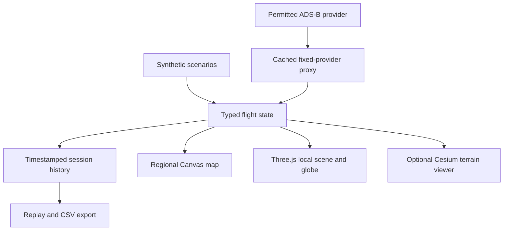

# Aeris architecture

## Implemented separation

`src/core.ts` owns units, WGS84 transforms, geodesic motion, feed normalization and source age. The UI does not deduce missing routes or airspeed. `src/data.js` keeps synthetic examples separate from the live adapter.

`src/map.js` draws regional geometry with a Mercator latitude transform. Its scale ruler accounts for latitude. Map selection and search share the same flight identifiers. Default geography is deliberately generalised; it is not satellite imagery.

`src/aircraft.js` builds a longitudinal body of revolution, continuous cambered/tapered wings, tail surfaces, turbofan nacelles and blades, windows and retractable display gear. Airframe envelope dimensions come from manufacturer reference figures. Models remain approximate; no copied model/livery asset is embedded. Four reusable GLB files are supplied in `models`.

`src/scene.js` uses a WGS84 east/up/south local frame in metres. It separates rendering from the reported state, respects reduced-motion preferences for camera damping, clamps pixel ratio, and offers a lower-cost rendering mode. It does not solve forces, control inputs or flight dynamics. Source-absent attitudes remain estimated. Camera controls are coupled to the aircraft position while orbiting, or detached for free movement.

`src/photoreal.js` is the optional higher-fidelity geography integration. It loads a pinned Cesium release, converts an original Three.js model to glTF, and positions it in Earth coordinates. It requests World Terrain and imagery and attempts Photorealistic 3D Tiles only within the account's permissions. Errors return the UI to the local scene. No provider token is stored on disk/localStorage.

`server.mjs` serves the prebuilt static app and one fixed upstream provider path. It is not an open URL proxy. Requests coalesce, successful data is cached for 15 seconds, and upstream errors receive backoff. The client displays disconnection and retains original report timestamps. Both network boundaries have explicit timeouts.

## Production work still needed

1. **Contract the data.** Choose a permitted provider for each product field: positions, extended Mode S, airframe registration metadata, schedules/routes, gate/terminal updates and weather. Define cache, attribution, redistribution and retention rules. Do not infer an airline schedule from a callsign alone.
2. **Normalize altitude correctly.** Preserve ellipsoidal altitude, orthometric/geoid height and barometric altitude as separate values with conversion provenance. Align with terrain elevation before attempting credible runway contact. Handle receiver timestamps, clock skew and position accuracy metadata (NIC/NAC) where supplied.
3. **Use a delayed render buffer.** For production tracks, interpolate reported ECEF positions and velocities with bounded acceleration/jerk, reject discontinuities and only extrapolate for a short explicit window. Estimate bank from coordinated-turn rate only when curvature/velocity estimates are robust; label that estimate. Real attitude or gear state is preferable when available.
4. **Replace approximate assets.** Use properly licensed, inspected aircraft/rotorcraft models with LODs, animation rigs, verified dimensions and variant mapping. Reuse mesh families but do not present a generic twin jet as a specific helicopter or turboprop. Keep unknown/low-confidence matching visible.
5. **Validate terrain end to end.** Test tile and elevation datum alignment, runway thresholds, terrain contact, geographic rebasing, ocean crossings and low-altitude occlusion. Photogrammetry alone is neither live nor globally complete.
6. **Build scalable ingestion.** Move provider access and session archives into a backend with caching, budgets, observability and per-client limits; stream only viewport-relevant traffic. Use instancing and LOD on global scenes. The current 100 NM Singapore proxy is not a global ingestion service.
7. **Test mobile devices.** Measure memory, thermal load, GPU support, battery, gestures, accessibility, lifecycle recovery, offline transitions and poor connectivity on actual iOS/Android devices. The included manifest is a web-app foundation, not an App Store/Play release.
8. **Package native shells only after the vertical slice works.** Capacitor is a possible next step for the web build; native signing, OS permissions, release pipelines and store submissions are not included.

## Accuracy contract for the full product

Every field should carry value, units, observation time, provider, reporting basis and confidence/classification: observed, derived, interpolated, extrapolated, reference or unavailable. The UI should preserve this distinction through maps, camera modes, replay, alerts and exports. A visually convincing 3D frame is not evidence of an accurate state estimate.

Further acceptance work: test WebGL context loss, long sessions, unknown aircraft variants, sparse receiver coverage, pressure/geometric altitude disagreements, delayed messages, large jumps, antimeridian crossings and aircraft disappearing between two snapshots. Successful compilation and DOM tests do not replace these tests.
