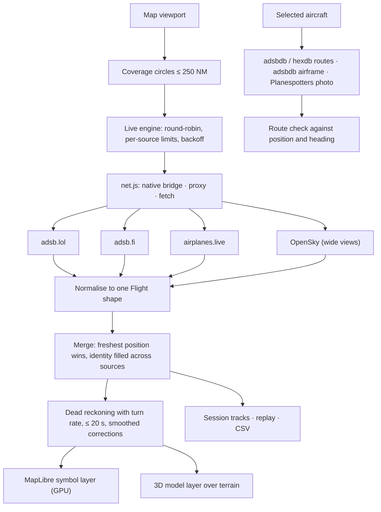

# Aeris architecture

## Data

- `src/providers.js` lists the sources, their URL builders, rate limits and terms. All readsb-style sources share one parser.
- `src/live.js` turns the viewport into coverage circles (`coverageCircles` in `core.ts`, hexagonal packing with overlap), refreshes the nearest circles every 1–2 s and outer ones less often, and alternates sources so none exceeds its limit. The selected aircraft is fetched by hex when it is outside the refreshed area. OpenSky is used only for wide views or when the readsb sources fail, within a daily credit budget kept in local storage. Errors back off per source (429 → exponential, 403 → 10 minutes).
- `src/core.ts` normalises readsb and OpenSky responses (feet, knots, ft/min; null when not reported), merges reports, predicts motion (`predicted`: constant-rate turn for up to 8 s, then straight, bounded to 20 s), checks routes (`routeFit`: cross-track distance, progress, heading) and builds great-circle lines that stay continuous across the antimeridian.
- `src/net.js` chooses the path per host: the iOS `WKScriptMessageHandlerWithReply` bridge, the Android `@JavascriptInterface` bridge, a configured proxy, or direct fetch for hosts that send CORS headers (adsbdb, hexdb, Planespotters).
- `src/enrich.js` caches lookups (routes 20 min, airframes 7 days, photos 3 days) in memory and local storage.

## Map and 3D

- `src/worldmap.js` hosts MapLibre GL JS v5 (OpenFreeMap styles, Esri satellite, globe projection). Aircraft are one GeoJSON source drawn as signed-distance-field icons recoloured on the GPU; positions are pushed at 4–9 Hz depending on how many are on screen, and only for the visible area. The selected aircraft has its own source updated every frame. If the tile service cannot be reached the map switches to bundled Natural Earth geography.
- The 3D view reuses the same map: terrain from AWS Terrain Tiles, the camera placed with `calculateCameraOptionsFromTo` (follow) or `calculateCameraOptionsFromCameraLngLatAltRotation` (cockpit), and `src/model-layer.js` drawing the Three.js model in MapLibre's WebGL context via `getMatrixForModel`.
- `src/geo.js` converts GNSS ellipsoid height to height above mean sea level with a 1° EGM96 grid (`data/geoid-1deg.bin`, under 2 m error at the 99th percentile), falls back to QNH-corrected pressure altitude, and keeps the model above terrain.
- `src/types.js` is the type catalogue; `src/aircraft.js` builds an original parametric model from it and scales it to the published dimensions. `src/studio.js` is the close-up model view.

## Native shells

- `ios/`: XcodeGen project, a `WKURLSchemeHandler` serving the bundled web app from `aeris://app/`, and the network bridge with a host allowlist. CI builds an unsigned IPA, a signed IPA when secrets exist, and runs the app in the iOS Simulator, printing its self-test and a screenshot.
- `android/`: `WebViewAssetLoader` plus the same bridge.

## Proxies

`server.mjs` (local) and `worker/worker.js` (Cloudflare) forward GET requests to the same host allowlist only, with a one-second cache to merge duplicate requests.

## Known limits

- Coverage and update rate depend on volunteer networks and their policies; adsb.lol says it may require API keys in future.
- Session tracks only: there is no historical flight database.
- Attitude, gear and airspeed are not available unless broadcast; estimates are labelled.
- Physical-device performance on older phones has not been measured.
