<p align="center"></p>
<h1 align="center">Aeris</h1>
<p align="center"><b>Add, track, view and simulate any flight.</b><br>Find any flight in the air, follow the people you care about, and keep a record of where you have flown. <br>(this project was vibe coded to experiment with model outputs)</p>
<p align="center">
<a href="https://github.com/shira421/aeris/releases/latest"></a>
<a href="https://github.com/shira421/aeris/actions/workflows/release.yml"></a>
<a href="LICENSE"></a>
</p>
<p align="center"><a href="#install"><b>Install</b></a> · <a href="https://shira421.github.io/aeris/"><b>Open the web app</b></a> · <a href="https://github.com/shira421/aeris/releases/latest">Release notes</a></p>

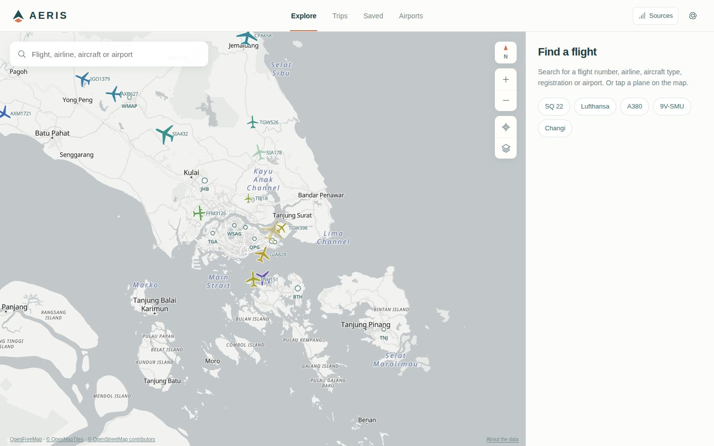

<sub>All images on this page are the real app with real live data, captured automatically by [`scripts/capture-media.mjs`](scripts/capture-media.mjs).</sub>

## Features

| | |
|---|---|
| **Live, worldwide.** Positions from four community ADS-B networks, refreshed about once a second, smoothed between reports. A new area is fetched the moment you pan to it. | 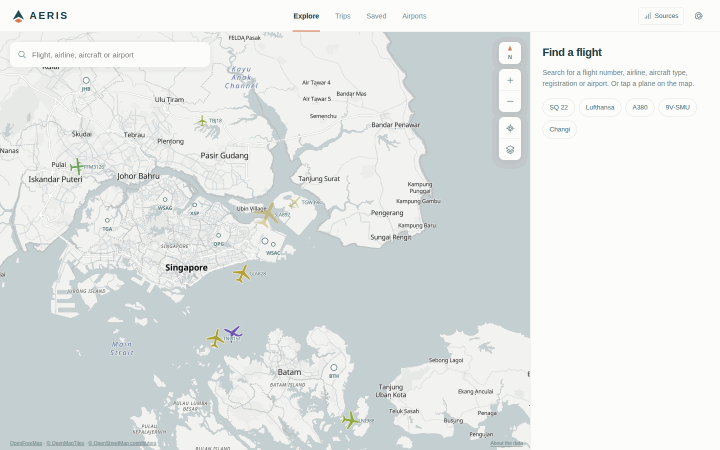 |
| **Search first.** Type a flight number (`SQ 22`, `SIA22`), an airline (`lufthansa`, `speedbird`), a registration (`9V-SMU`), an aircraft type (`A380`, `dreamliner`) or an airport. A flight anywhere in the world appears in the results, and the map goes to it. | 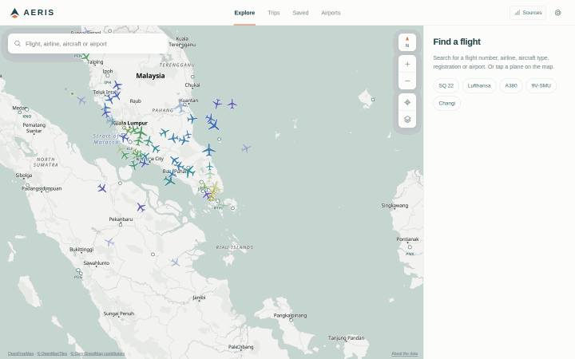 |
| **Every detail that is known.** Route checked against where the plane really is, progress and time to go, airframe and photo, and full telemetry. | 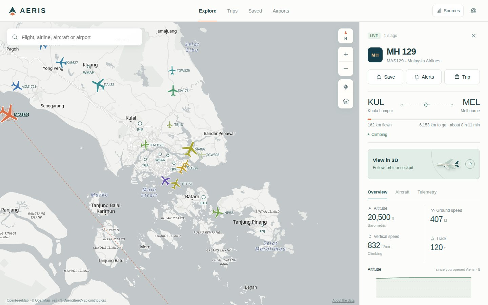 |
| **3D over real terrain.** Follow, orbit or sit in the cockpit, with satellite imagery and elevation. | 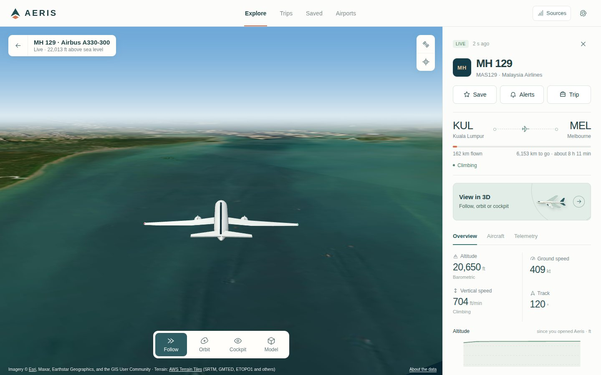 |
| **Trips.** Group dated flights into a trip. The map shows its routes and only its planes; each flight gets alerts on its day. | 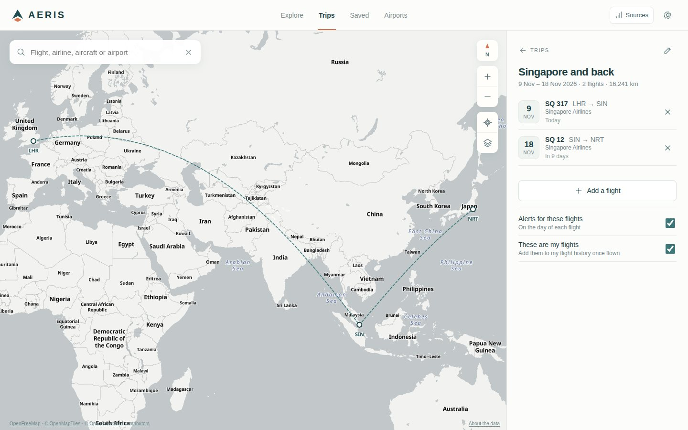 |
| **Flight history.** Flights you take are logged after Aeris sees them land; past ones can be added by hand. Your year in flights, kilometres, airports and airlines. | 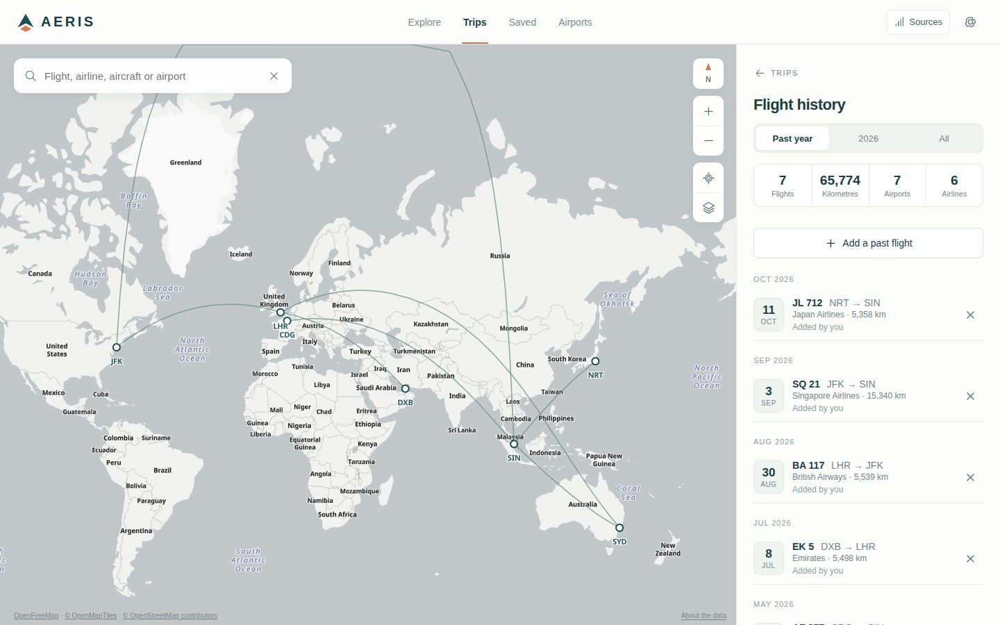 |

<p align="center">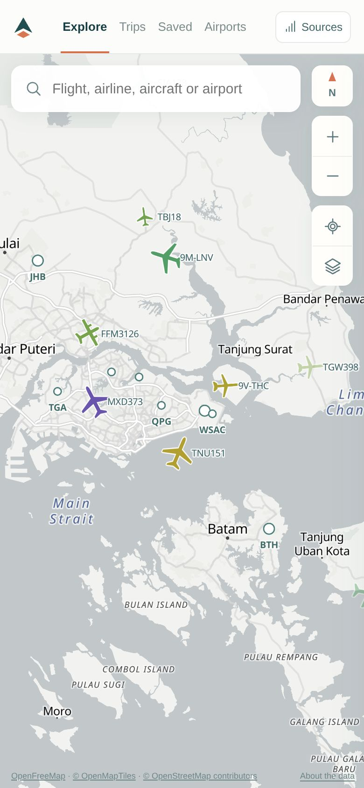&nbsp;&nbsp;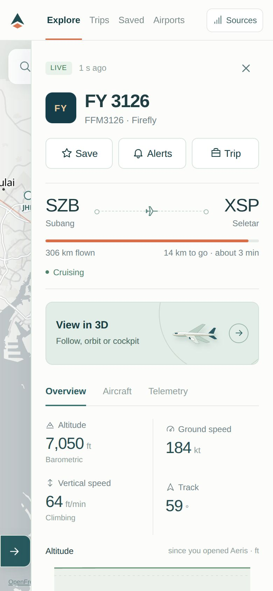</p>

**Alerts** for saved flights and trips: took off (from which airport), in the air, descending into the destination, landed (at which airport), emergency codes. Each is sent **once per flight** and states only what was observed: no guesses when a plane is out of coverage. Choose *Next flight*, or *Every flight* for someone who flies the same route regularly.

## Install

| Platform | How | Live data |
|---|---|---|
| **iPhone / iPad** | Download [`Aeris-iOS-unsigned.ipa`](https://github.com/shira421/aeris/releases/latest/download/Aeris-iOS-unsigned.ipa) and install with [SideStore](https://sidestore.io), [AltStore](https://altstore.io) or [Sideloadly](https://sideloadly.io). A free Apple ID needs a refresh every 7 days. | Direct |
| **Android 8+** | Download [`Aeris-Android.apk`](https://github.com/shira421/aeris/releases/latest/download/Aeris-Android.apk) and open it. | Direct |
| **Web** | Open [shira421.github.io/aeris](https://shira421.github.io/aeris/). To install it: Safari → Share → *Add to Home Screen*, or Chrome → *Install app*. | Through the [Aeris relay](#web-app-live-data) |

The links above always point to the **latest stable release**. Builds of every commit are in the [`latest-build`](https://github.com/shira421/aeris/releases/tag/latest-build) pre-release; AltStore/SideStore can follow them with the source `https://github.com/shira421/aeris/releases/download/latest-build/altstore-source.json`.

## How it works

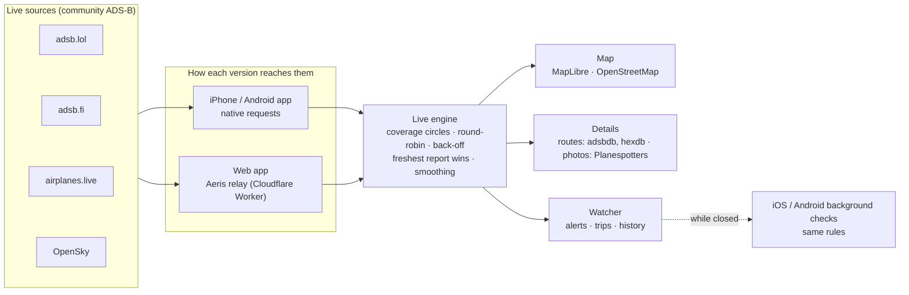

- **Fresh by design.** The area on screen is split into circles of up to 250 NM, each fetched about once a second, alternating between sources so each stays within its published rate limit. A source that refuses or rate-limits is paused and the others carry on. Measured in CI: 120–500 ms per request, positions 0.3–1.5 s old.
- **Honest between updates.** Planes move along their reported track and turn rate for at most 20 s, fade when their data is 15 s old and disappear after a minute.
- **Checked routes.** Route databases list the usual route for a flight number, which is often stale. Aeris shows a route only when the plane is on it.
- **Always live.** There is no demo mode. If live data cannot be reached (offline, or a web copy without a relay), Aeris says so once and keeps trying.

### Alerts, one leg at a time

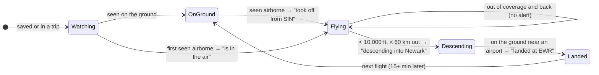

Each alert kind is sent at most once per leg. The app and the phone's background checks share their state, so whichever sees an event first sends it and the other stays quiet. While Aeris is open it checks every minute; when closed, iOS and Android allow a check every 15 minutes or so.

## Web app: live data

Browsers may not read the live feeds directly (they send no CORS headers), so the web app reads them through a tiny relay, [`worker/worker.js`](worker/worker.js). It forwards GET requests to the flight-data hosts only, serves only the Aeris web app, and stores nothing. It runs on Cloudflare's free tier (100,000 requests a day).

**One-time setup:** add two repository secrets, then push to `main` (or run *Deploy web app to GitHub Pages*):

1. Create a free Cloudflare account and open **Workers & Pages** once (this creates your `workers.dev` address).
2. **My Profile → API Tokens → Create Token → "Edit Cloudflare Workers"**, and copy the token.
3. In GitHub, **Settings → Secrets and variables → Actions**, add `CLOUDFLARE_API_TOKEN` and `CLOUDFLARE_ACCOUNT_ID` (shown in the Workers & Pages overview).

The Pages workflow then deploys the relay, checks that live data comes through it, and builds the site to use it. Release builds of the web app and the standalone `Aeris.html` use it too. Without the secrets the site still works and tells visitors once that live data is unavailable.

## Develop

```sh
npm install
npm start                    # http://localhost:4173, with a local relay at /api/proxy
npm test                     # unit tests (rules, search, live engine, relay) and server checks
npm run test:browser         # headless Chrome, desktop and phone sizes, feeds mocked
npm run test:live            # real feeds, tiles, routes and 3D (needs internet)
npm run test:android-rules   # Android's alert rules match the web app's (needs a JDK)
node scripts/capture-media.mjs   # the README images (needs internet)
```

<details>
<summary>Project layout</summary>

| Path | What |
|---|---|
| `src/app.js` | Interface |
| `src/live.js`, `src/providers.js`, `src/net.js` | Live engine, sources, native bridge / relay / fetch |
| `src/core.ts` | Parsing, prediction, geodesy, route check |
| `src/search.js` | What a query means: flight numbers, airlines, types, registrations |
| `src/collection.js`, `src/rules.js` | Saved items, trips, history, alert rules (and their bundle for iOS) |
| `src/worldmap.js`, `src/model-layer.js`, `src/studio.js` | Map and 3D |
| `src/airports.js`, `src/enrich.js`, `src/types.js`, `src/geo.js` | Airports, routes and photos, aircraft types, geoid |
| `ios/` | XcodeGen project, WKWebView shell, location, notifications, background checks |
| `android/` | WebView shell, location, notifications, background checks (`Rules.java`) |
| `worker/` | The web app's relay |
| `.github/workflows/` | Builds, tests, releases, Pages, provider probe, README media |

Every push to `main` builds the iOS and Android apps and the web app, runs the tests (including the app in the iOS Simulator and an Android emulator), and updates `latest-build`. A new version number in `package.json` publishes a permanent release.
</details>

<details>
<summary>Accuracy notes</summary>

- Pressure altitude is not height above sea level. The Telemetry tab shows both, with the basis used (EGM96 geoid, QNH when reported).
- Attitude in 3D is estimated: heading from track, pitch from vertical and ground speed, roll when reported. Models match published dimensions; liveries are not modelled.
- Coverage depends on volunteer receivers: dense over land and busy regions, thin over oceans.
- Airport data is reference data, not operational status.
</details>

## Privacy

No account, no analytics. Saved flights, trips and history stay on your device. Your location is used only to place you on the map, and only if you allow it. The relay stores nothing.

## Licences and credits

Code, logo and models: MIT ([`LICENSE`](LICENSE)). MapLibre GL JS (BSD-3-Clause), Three.js r160 (MIT, vendored). Map data © OpenStreetMap contributors via OpenFreeMap and OpenMapTiles; satellite imagery © Esri, Maxar, Earthstar Geographics and the GIS User Community; terrain: AWS Terrain Tiles. Live data under each provider's terms (adsb.lol: ODbL 1.0). Routes and airframes: adsbdb, hexdb. Photos: Planespotters.net, credited per photographer. Airports: OurAirports (public domain), time zones from mwgg/Airports (MIT). Airlines: OpenFlights (ODbL 1.0). Geoid: NGA EGM96 via OSGeo. Offline geography: Natural Earth and DataMaps.
